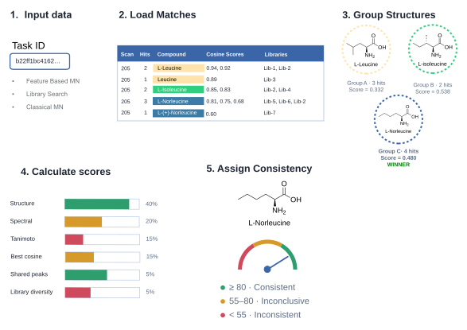
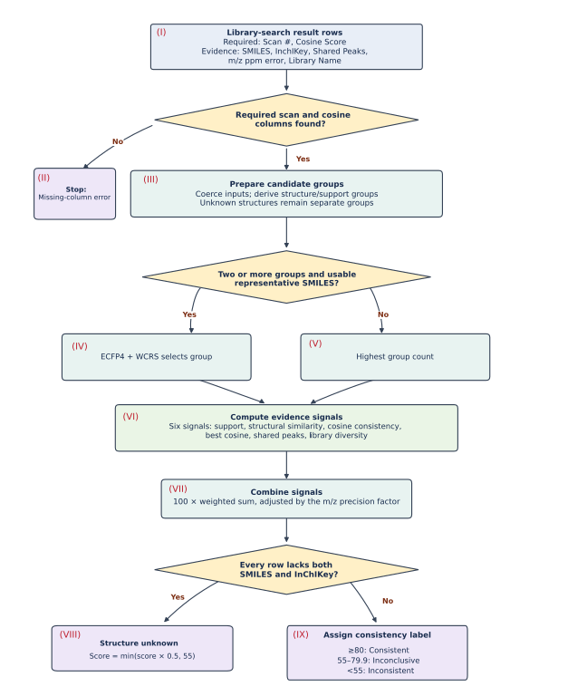

# GNPS2-AnnEx: Annotation Evidence Explorer

GNPS2-AnnEx scores how consistent the evidence behind a GNPS2 spectral library annotation is. Give it a GNPS2 task ID and it loads the library matches, groups the candidate structures for each MS/MS scan, and gives every scan a 0–100 confidence score with a traffic-light label and a per-metric breakdown.

It supports **Feature-Based Molecular Networking (FBMN)**, **Classical Molecular Networking** and **Library Search** tasks.

<p align="center">
  
</p>

## How it works

1. **Enter a task ID.** Paste a GNPS2 task ID on the landing page, or pass it in the URL.
2. **Load matches.** Library matches are fetched from GNPS2. The loader tries several strategies depending on the workflow and caches results for 24 h.
3. **Group structures.** Hits for each scan are grouped by planar structure, with stereochemistry ignored and positional isomers merged. When there are two or more candidate groups with usable SMILES, the representative group is chosen by WCRS (Weighted Centroid Representativeness Score, based on ECFP4 Tanimoto). Otherwise the group with the most hits wins.
4. **Calculate scores.** Six evidence signals are combined into a weighted score.
5. **Assign a label.** The score is mapped to a consistency label.

### Score components

| Signal | Default weight | What it measures |
|---|---|---|
| Structure agreement | 40% | Fraction of hits that support the winning structure group, with Bayesian shrinkage (α = β = 1) so single-hit scans don't score 1.0 |
| Tanimoto (WCRS) | 15% | Weighted average ECFP4 similarity from the winning group to the other candidate groups |
| Cosine consistency | 20% | `1 − CV` of the cosine scores within the winning group (0 for single-hit groups) |
| Best cosine | 15% | Highest cosine score in the winning group |
| Shared peaks | 5% | Shared peaks as a fraction of the query spectrum's peak count |
| Library diversity | 5% | Number of distinct source libraries in the winning group (capped at 5) |

```
score = 100 × Σ(weightᵢ × signalᵢ) × mz_precision
```

Two adjustments are applied after the weighted sum:

- **m/z precision.** If the median absolute ppm error of the winning group is above 5 ppm, the score is multiplied by 0.7.
- **Unknown structure.** If no hit in the scan has a SMILES or an InChIKey, the score becomes `min(score × 0.5, 55)` and the scan is labelled *Structure unknown*.

### Confidence labels

| Score | Label | Colour |
|---|---|---|
| ≥ 80 | Consistent evidence | green |
| 55–79.9 | Inconclusive | yellow |
| < 55 | Inconsistent evidence | red |

The full decision flow:

<p align="center">
  
</p>

All thresholds and constants live in [`bin/constants.py`](bin/constants.py), and the default weights are in [`bin/scorer.py`](bin/scorer.py).

## Quick start

### Docker

```bash
make server-compose              # build and run in the background
make server-compose-interactive  # dev mode with live reload
make attach                      # shell into the running container
```

### Local

```bash
pip install -r requirements.txt
python main.py                   # Flask dev server on http://localhost:5000
./run_server.sh                  # gunicorn (production)
```

> `numpy<2` is pinned because `ms_entropy` does not support NumPy 2.

## Usage

Open `/` and enter a task ID, or link straight to the dashboard:

```
/dashinterface2/?task=<task_id>&workflow=auto
```

| Parameter | Description |
|---|---|
| `task` | GNPS2 task ID |
| `workflow` | `auto` (default), `classic`, `fbmn` or `librarysearch` |
| `scan`, `detail=1` | Open the detail panel for a single scan |
| `w_structure`, `w_tanimoto`, `w_spectral`, `w_cosine`, `w_shared`, `w_lib_div` | Override the score weights (percent; re-normalised to sum to 100) |
| `ppm_sigma`, `ppm_floor` | Override the m/z precision penalty settings |

The detail panel shows a score gauge, the per-metric breakdown with each metric's contribution, the query spectrum and molecule images for the candidate structures.

Example tasks:

- FBMN: [`b22ff1bc41624e29a28cf6e12fe17ad5`](https://gnps2.org/status?task=b22ff1bc41624e29a28cf6e12fe17ad5)
- Library Search: [`91e506239b35496d980f38b9070c4bd1`](https://gnps2.org/status?task=91e506239b35496d980f38b9070c4bd1)

## Other interfaces

- **Standalone web app:** [`webapp/gnps2_annex_standalone.html`](webapp/gnps2_annex_standalone.html) is a single-file HTML version of the dashboard.
- **Everything Bagel plugin:** [`eb_plugins/annotation-evidence-checker.html`](eb_plugins/annotation-evidence-checker.html) brings the evidence checker into the GNPS2 Everything Bagel Feature Finder app. See [`eb_plugins/WRITING-PLUGINS.md`](eb_plugins/WRITING-PLUGINS.md).

## Project layout

| Path | Role |
|---|---|
| `app.py`, `main.py`, `views.py` | Flask app, entry point and routes |
| `dash_interface2.py` | Dash dashboard: layout, URL parsing, loading and scoring callbacks |
| `components.py` | Detail panel, breakdown table and molecule images |
| `bin/loader.py` | Fetches library matches from GNPS2 |
| `bin/normalizer.py` | Column normalisation and structure grouping |
| `bin/scorer.py` | Per-scan confidence scoring |
| `bin/tanimoto.py` | ECFP4 Tanimoto / WCRS |
| `bin/constants.py` | Tunable constants and timeouts |

## Citation

A manuscript describing GNPS2-AnnEx is in preparation. Until it is published, please cite this repository.
